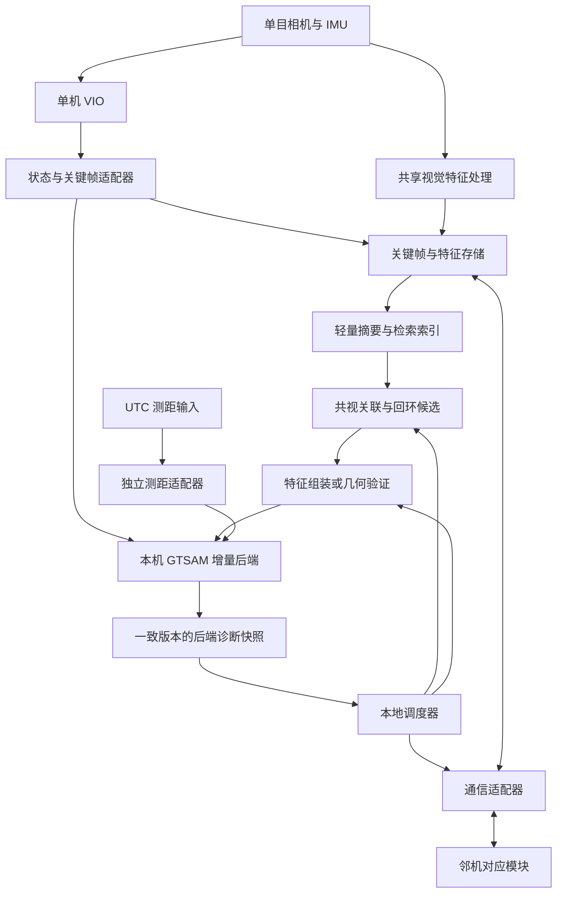

> 这是用户讨论与决策文档的快照。当前已实现范围以 PHASE1.md 为准；未决方案不表示已经完成。

# 单目集群异步多观测调度系统设计方案

版本：v0.1  
日期：2026-10-23（Asia/Shanghai）  
状态：方案草案，供用户补充和决策；尚未实施代码重构或验证性能。

> 本文整理本轮讨论形成的整体方向，作为后续实现和实验的设计基准。文中的“建议”不等于用户已经确认。本文更新了早期《Omni-swarm_单目精简重构设计.md》中沿用 Ceres 和集群帧的方向；旧文保留作讨论记录。

## 0. 如何使用本文

- **讨论方向**：用户已明确提出并持续讨论的目标，不代表实现已经完成。
- **设计建议**：为形成可执行方案提出的默认做法，可以修改。
- **待澄清 U-xx**：缺少输入事实，需要用户补充。
- **待决策 D-xx**：存在会改变系统结构或研究结论的选项，需要用户选择。
- 第 14 节给出决策表，第 15 节给出材料补充表。先填写高优先级项即可，不要求一次确定所有阈值。
- 公开框架事实与本机代码检查分别标注为 `[Rxx]`、`[Lxx]`；本文提出的架构和调度策略属于设计建议，不能当作已验证结果。

## 1. 研究目标与问题边界

### 1.1 核心问题

在没有中心节点掌握全部观测的条件下，每个节点依据自身已获得的状态、观测和有限邻机摘要，决定：

1. 什么时候检索潜在机间回环；
2. 请求、传输和使用哪些共视特征；
3. 验证、接入哪些回环候选；
4. 如何使用测距，必要时是否调整其请求或处理频率；
5. 在可接受的相对定位误差和风险下，减少通信数据量及计算开销。

主要评价对象是**相对状态估计质量与资源消耗的关系**，不把减少回环数量本身作为目标。

### 1.2 当前讨论方向

- 每台机器以单目相机＋IMU 的 VIO 为运动基底，采用 VINS-Fusion 或兼容输出。VINS-Fusion 官方支持该传感器组合。[R01]
- 每台机器运行独立的 GTSAM / iSAM2 协同后端，处理自己获得的观测。
- 采用点对点信息交换，不依赖在线中央全局调度器。
- 暂不实现 ADMM、节点间乘子更新或分布式求解器共识迭代。
- 使用统一 UTC 采样时间框架，解除对 Omni-swarm UWB 时间参考的依赖。
- 状态关键帧由各机视觉/VIO 流驱动；UWB、回环和特征观测异步关联状态。
- 协同信息有三类约束表达：共视重投影、相对位姿回环、UWB 测距。
- 通信实现参考 Omni-swarm，但状态和观测组织重新设计。
- 实验先做双节点、再扩展五节点；单机多 ROS master 可用于初步算法验证。

### 1.3 暂不纳入首版

- 从零开发单机 VIO。
- 保留鱼眼展开、双目左右图、多方向匹配等全部旧相机路径。
- 同时研究关键帧删减、视觉前端替换、分布式优化与通信调度四个问题。
- 自动保证真实漂移有界、回环必然成功或严格维持某个有效观测频率。
- 将纯单目、未恢复米制尺度的平移直接接入米制机间约束。
- 以集中式方案替代主研究目标。COVINS-G 仅作架构或对照参考。

## 2. 总体架构

### 2.1 每节点模块



图中是逻辑职责，不要求每个框都成为一个 ROS 节点。可先在一个协同进程内实现小模块，VIO 保持独立。

### 2.2 “去中心化”与“分布式优化”的界限

本方案的去中心化体现在：各节点独立获取观测、运行后端和作出通信决策。各节点可以保存自身及部分邻机的状态变量，不要求每机完整复制全部五机历史。

本方案首版不要求各节点对共享变量迭代求共识。因此：

- 不同节点获得的信息和估计结果可以不同。
- 本机联合协方差是**给定本机已获得信息的模型不确定性**，不是全局最优联合协方差。
- 不直接把邻机融合后的后验当作独立测量再融合，避免信息循环。
- 观测可以被多节点分别使用，但同一节点内部必须去重；转发必须保留原始来源和观测 ID。
- 若未来要求跨节点输出严格一致，需要另立一致性/分布式求解设计，不把这一要求隐藏在通信层里。

## 3. 单目前端、SuperPoint 与三维地标

### 3.1 数据链路

```text
单目图像 → 特征及描述子 → 跨帧跟踪/关联
                             ↓
          米制 VIO 位姿＋多视角三角化/地标估计
                             ↓
           带有效性和坐标定义的特征—三维点对应
                             ↓
                 机间匹配、PnP 或共视因子
```

SuperPoint 本身不输出米制深度。D²SLAM 的相关机制是：VINS 地标管理进行多视角初始化，回环模块按地标 ID 读取有效三维点参与 PnP，而不是找到回环后再临时做双目深度恢复。[R02][R03][R04]

这条机制可以借鉴，但不表示 D²SLAM 模块能直接替换 VINS-Fusion 或 Omni-swarm 的模块。

### 3.2 推荐的快速适配路线，待 D-02 确认

首版保留 VINS-Fusion 的运动估计路径，在协同视觉分支提取、跟踪 SuperPoint 特征，并用 VIO 相机位姿为这些**同一特征轨迹**初始化三维点。这些点首先服务于匹配和 PnP；其统计相关性另见第 7 节。

如果改为复用 VIO 原生地图点，必须通过特征 ID 或经过验证的像素关联找到对应描述子。不能把 VIO 三维点与另一次 SuperPoint 提取结果按数组顺序拼接。

将 VINS-Fusion 内部跟踪器整体改成 SuperPoint 是另一条路线，会增加前端改动和基线漂移，需单独选择。

### 3.3 三维点有效性

- 记录特征 ID、宿主关键帧、观测帧、标定版本和三维点坐标系。
- 只有通过视差、正深度、重投影及轨迹质量检查的点可参与几何估计。
- 未初始化点仍可保留二维观测，但不能使用零深度或默认深度冒充有效三维点。
- 单目深度继承位姿基线的尺度；只有 VIO 完成有效米制初始化后才按米制处理。
- 后端修正轨迹时，前端局部 VIO 坐标与其地标版本不能被无记录地改写。
- 初版不把协同后端校正直接反馈给 VIO 内部状态；输出层可以组合坐标变换，避免回灌形成隐蔽信息循环。

## 4. 状态与关键帧管理

### 4.1 不再以 UWB 集群帧作为状态容器

每台机器独立维护视觉关键帧状态链：

```text
A: A0(0.00) ──VIO── A1(0.10) ──VIO── A2(0.20)
B: B0(0.03) ──VIO── B1(0.13) ──VIO── B2(0.23)
```

每个关键帧有独立键 `(agent_id, session_id, frame_id)` 和真实采样时间，不要求 A1 与 B1 同时发生。在线的“集群状态”是按需查询结果，不是必须同步生成的全体状态帧。

### 4.2 四种动作解耦

1. 接收 VIO 和维护运动链。
2. 关键帧/描述子进入本地与远端索引。
3. 搜索候选。
4. 请求详细数据、几何验证和接入因子。

调度跳过第 3 或第 4 项，不默认跳过第 1、2 项。首版建图和缓存策略在各对照组固定，避免把数据库稀疏化收益误认为调度收益。

### 4.3 关键帧与历史保留

- 推荐先接收 VIO 的合格关键帧，必要时增加明确的最大时间间隔；具体规则待 D-06。
- 用于回环检索的视觉关键帧必须有可查询的后端端点或明确的历史表示。
- 首版建议保留稀疏历史位姿节点，近期共视地标另设生命周期。
- 视觉数据库、特征缓存和优化图是三个不同容器，各自过期策略必须一致可追踪。
- 固定时滞会边缘化旧变量；不能假设重新插入一个同名节点就恢复原来的历史信息。[R07]
- 后续若需长期限内存，再决定子图、历史位姿图或严格边缘化策略，不默认把旧回环搬到最近节点。

### 4.4 后端状态范围，待 D-01、D-03

基础变量是各机关键帧位姿。共视约束需要共同地标：可以显式维护地标，也可以用 Smart Factor 消去地标。[R08]

- 单机速度和 IMU bias 首版仍由 VIO 维护，不默认在协同后端再次独立估计。
- 若 UWB 内插采用依赖速度的模型，需要明确速度是新增状态、带噪声输入还是固定近似，不能无声引入额外自由度。
- 4-DoF 方案需处理 VIO 提供的 roll/pitch 及其误差；6-DoF/Pose3 方案需处理重力约束、完整旋转噪声和 gauge。此处尚未决定。

## 5. 三类协同约束

以下公式是模型说明，具体误差所在坐标、变量顺序和噪声需在实现前统一。令 `T_A_B` 把 B 系点变换到 A 系，`X_i,k = T_W_Bi,k`，相机和 UWB 标签外参分别为 `T_B_C`、`T_B_U`。

### 5.1 运动基底：VIO 增量

连接同机相邻关键帧：

\[
r^{odom}_{i,k}=\operatorname{Log}\!\left((Z^{odom}_{i,k})^{-1}X_{i,k}^{-1}X_{i,k+1}\right).
\]

VIO 输出的两个绝对位姿共享历史信息，其增量噪声不能简单由两个边缘协方差相加得到。噪声来源和时间相关性处理待 D-04，不把 VIO 当作无噪声运动真值。

### 5.2 共视特征重投影

同一共同地标 `P_l` 在多个机器/时刻被观测，残差示意为：

\[
r^{proj}_{i,k,l}=z_{i,k,l}-\pi\!\left((X_{i,k}T_{B_C,i})^{-1}P_l\right).
\]

用于有可靠共同地标的协同估计，调度单位优先为**地标轨迹组/观测组**，而非互不相关的像素点。

VIO 三维点可以提供初值或候选匹配支持；把它固定成已知真值后做 PnP，不等于完成了联合重投影优化。

### 5.3 历史/机间位姿回环

回环因子直接引用原始关键帧键：

\[
r^{loop}_{a,b}=\operatorname{Log}\!\left((Z^{loop}_{a,b})^{-1}X_a^{-1}X_b\right).
\]

允许两端时间不同；不先转移到 UWB 帧或最近集群关键帧。PnP 结果的变换方向、相机到机体转换、协方差的局部坐标都需显式记录。

回环成功与否仍未知。调度器控制搜索/验证机会，而不是保证周期性产生有效回环。

### 5.4 UWB 测距

若设备测距模型可近似为同一有效时刻 `tau` 的瞬时距离：

\[
r^{range}_{ij,\tau}=\|p_{U_i}(\tau)-p_{U_j}(\tau)\|-d_{ij,\tau}.
\]

标签位置从机体位姿和外参计算。测距偏置、NLOS 外点、有效采样时刻、是否需要双端不同时刻模型均待澄清。现有话题若只包含 UWB 设备时间，仍需在输入适配器中完成一次可验证的 UTC 映射。

若硬件不能按需触发测距，减少后端使用量不等于减少射频测距开销；该结论需与 D-10 分开。

### 5.5 三类约束如何共存

| 约束 | 主要服务目标 | 可用性前提 | 可调度动作 |
|---|---|---|---|
| 共视重投影 | 持续相对定位精度 | 可靠特征关联、足够几何条件 | 选轨迹、请求特征、更新批次 |
| 位姿回环 | 轨迹闭合与长期一致性 | 存在可匹配关键帧并通过几何验证 | 检索时机、候选验证、数据请求 |
| UWB 测距 | 相对距离信息 | 有效测距、时间及外参 | 请求/传输/处理，视硬件能力而定 |

三类约束只有视觉和 UWB 两类物理信息来源。共视与回环可能复用同一批像素，不能默认独立。

“近场/远场”不按固定距离硬切：重点区分当前持续共视和历史地点重访。D²SLAM 的近场协同 VIO 和全局 PGO 是分层机制；不能据此推导本方案应把近场回环全部关闭。[R02]

## 6. 时间与异步更新

### 6.1 时间契约

- 数据输入前提：各设备使用同一 UTC 时间框架；精度与残余偏差尚待 U-02。
- 保留传感器采样时间，不用接收时间覆盖，也不强制把各机时间戳改为集群帧时间。
- 除 UTC 纳秒时间外，记录本机单调时钟的接收、排队、处理时间，用于耗时统计。
- 统一跨机 UTC 不代替单机相机—IMU 时间标定。
- 采用明确 session 和时间回退处理；数值运算可减固定公共起点，但不丢失原始时间与 ID。

### 6.2 非关键帧时刻的测距

对 `tau=0.08` 的测距，可以由 A0/A1、B0/B1 关联两机在该时刻的状态。插值因子需随相关状态重新计算残差/Jacobian，而不是先生成固定的两个虚拟位置。

- 插值方式、最大允许间隔和运动噪声由 D-07 决定。
- 应传播相关状态的联合不确定性，并表示插值模型的额外误差。
- 若后侧关键帧尚未到达，先缓存；不能使用实验中尚未到达的未来数据。
- 等待、超时、外推和拒绝需分别记录。首版建议优先有界等待，避免无标记外推。
- 若插值不确定性依赖状态或多个测量共享插值过程，需要明确其近似和相关性，不能靠任意膨胀常数宣称严格正确。

### 6.3 优化更新事件

1. 新关键帧：新增本机状态与运动因子。
2. 新跨机观测：端点和初始化就绪后新增因子；必要时新增缺失但可合法构造的邻机状态。
3. 延迟回环：引用历史端点并增量修正相关轨迹；端点已被边缘化时转入明确的历史处理策略，不静默重定位到新端点。
4. 后端可以短批次更新，不要求每条消息立即求解。[R05]
5. 每次更新后发布版本一致的位姿、协方差和输入截止信息。

“异步”表示到达时间和状态时间不同，不表示可以忽略因果关系、缺失状态或历史数据管理。

## 7. 信息相关性、初始化与统计边界

### 7.1 必须正面处理的两种重复计权

**第一种：同一批视觉特征同时形成重投影和位姿回环。**

如果回环位姿由同一批像素或地标估计而来，再把压缩因子与原重投影因子视为独立相乘，就会重复计权。建议为每个视觉因子保留其输入观测 ID，首版同一图内对同一观测集合只选择一种表示。PnP 可以只用于关联验证或初始化，而不额外加位姿因子。

**第二种：VIO 增量与复用的视觉数据相关。**

即使不重复加入回环因子，VIO 增量也可能已经使用了相同图像/跟踪数据。独立特征提取分支不自动消除其与 VIO 的相关性。把 VIO 地图点当作固定真值还会忽略其位置误差。

因此有两个研究范围选项，待 D-04：

- **松耦合经验验证版**：明确记录相关性近似，通过真值、覆盖率、噪声校准检验实际后果；可以验证调度收益，不能仅凭 Hessian 协方差宣称严格稳定性保证。
- **统计一致性优先版**：明确原始测量的使用归属，保留需要的交叉相关/边缘化信息，或设计一致的联合模型。其实现范围更大，不应被当成现成接口已经解决的问题。

首版建议先采用前一版，但只有用户接受其结论边界后才冻结实验模型。

### 7.2 地标表示注意事项

- 显式地标便于检查来源、初始化和协方差，但增加变量及生命周期管理。
- Smart Factor 可以消去地标，但并不替代错误关联检查、噪声建模或历史管理。[R08]
- 官方 `SmartProjectionPoseFactor` 的共享标定假设不能直接套用于内参不同的多机；需选支持对应标定/相机模型的因子或适配归一化观测及其噪声。[R08]
- 同一地标增加观测后，应更新/替换其因子或添加明确的新观测，不得把旧观测反复作为独立新信息加入。

### 7.3 初始化和不可观方向

- 各机 VIO 都恢复米制尺度，不等于各机坐标系已经对齐。
- UTC 对齐也不提供空间位置、偏航或地图变换。
- 需要通过可靠机间回环、共同地标或具有足够运动几何的测距建立机间联系。
- 不能假设一次 UWB 距离就确定完整相对位姿。
- 图未连通/相对方向不可观时，返回明确的 `uninitialized/disconnected/unobservable`，不是零协方差。
- 参考系固定用于消除 gauge，不能把每机独立原点都当作同一世界坐标下的精确已知位姿强行锚定。图合并时需一致处理参考系和先验。
- 初始化阶段建议采用所有对照组相同的固定发现策略；开始调度的时点与已有初始信息必须一致。

### 7.4 外点和质量控制

保留相机标定、时间检查、重投影检查、视差/几何退化检查、测距异常检查、鲁棒处理及观测去重。调度器不能因为“需要信息”就放宽几何验收门限。

## 8. GTSAM 后端与不确定性维护

### 8.1 选择原因与边界

iSAM2 适合增量加入状态和因子，其 Bayes tree 可用于查询当前线性化高斯模型下的边缘/联合信息。[R05]

这不表示持续保存完整稠密协方差，也不保证查询没有成本。应固定 GTSAM 版本、提交和构建选项，验证实际可用的 C++/Python 接口。[R06]

Ceres 可保留作旧基线或小图数值对照，不建议首版同时维护两套完整在线系统。Ceres 的协方差计算同样依赖残差正确白化和正确的秩/gauge 处理。[R09]

### 8.2 相对协方差

对本机图内两个状态，先提取联合协方差块：

\[
P_{joint}=\begin{bmatrix}P_{aa}&P_{ab}\\P_{ba}&P_{bb}\end{bmatrix},\qquad
P_{rel}=J_{rel}P_{joint}J_{rel}^{T}.
\]

- 交叉协方差是相对误差传播的输入，不独立作为“系统稳定”阈值。
- `J_rel` 必须对应实际状态参数化、误差切空间和相对变换方向。
- 查询同一物理时刻的相对状态时，两端若需内插，应取所有参与状态的联合协方差并传播，不把不同时刻的“最新状态”直接当同步相对状态。
- GTSAM 的旋转/平移切空间顺序、Ceres 旧四维状态顺序、消息中的四元数顺序不能混用。
- 用小图批量解、数值差分或 AutoDiff 检查自定义因子与相对变换 Jacobian；无须仅为了查询协方差而重写所有解析 Jacobian。

### 8.3 评估状态可靠性的最小信息

1. 相对位置协方差的最大特征值及相对偏航方差；6-DoF 时补充任务需要的旋转方向。
2. 不获得新协同视觉观测时，短时预测的不确定性与增长趋势。
3. 新观测进入优化前的预测残差/一致性统计，不只记录通过筛选后的样本。
4. 初始化、图连通性、模型退化、数据新鲜度、查询成功标记。

位置和角度单位不同，不能不经尺度定义就直接比较混合协方差最大特征值。容许误差、归一化方式和控制指标待 D-09。

### 8.4 预测时必须声明观测假设

“未来 H 秒没有新回环”与“未来 H 秒没有任何协同视觉观测”不同。预测需明确：运动输入、已安排且可能到达的测距/共视数据、噪声模型和成功概率。

首版建议对尚未成功且未接收的回环不预先计入确定信息。若使用概率预测，应标记其为期望风险，不作为必然满足的误差上界。

协方差小不保证没有系统偏差；PCRB/CRB 低于容许误差只是下界条件，不能反向证明真实误差低于该阈值。

## 9. 面向三类观测的调度设计

### 9.1 第一版先固定什么

- 关键帧产生规则、状态保留、描述子模型与数据库覆盖规则固定。
- 几何验收和外点阈值在各对照组固定。
- 后端状态维数、因子模型和噪声固定。
- 本地 VIO 正常运行；调度不通过人为损伤运动基底制造收益。
- 首版把 UWB 作为一致的背景观测，视觉调度先成立；是否进一步联合调度 UWB 由 D-10 决定。

### 9.2 两层视觉决策

**候选未知时：调度发现机会。**

利用后端风险、轻量外观摘要、已知邻机关系和数据时效，决定是否发起检索、向谁请求候选信息。不能先完成昂贵匹配/PnP，再把它的成功结果作为此前的触发依据。

**关联已有时：调度观测组。**

对已知共同地标轨迹或可用候选，比较其预期相对状态收益与数据/验证/后端成本，选择一组请求和约束。共视约束的可用性通常比未知回环更明确，但它仍可能丢失、失配或退化。

### 9.3 收益评分的适用前提

在局部线性高斯、噪声独立且模型有效的条件下，可用下式作为候选组的信息收益示意：

\[
I(S)=\tfrac12\log\det\left(I+R_S^{-1/2}H_SP H_S^T R_S^{-T/2}\right).
\]

实现须确认状态包含哪些变量；若地标是未知量，不能固定它后只计算位姿 Jacobian 就宣称得到正确收益。应在完整联合模型或合理消元后评价。

同一地标内的像素、同一图像的多个候选、重叠数据响应会共享状态/数据成本。首版优先按轨迹或候选组评分，不简单累加每个像素的独立收益。

把候选概率乘以信息收益是一种可验证的启发式；它与严格的期望 logdet 不总是相等。三类约束应对同一任务状态比较收益，不按残差维数直接比较价值。

### 9.4 容错与运行边界

- 设置最大检索间隔、风险触发和适当滞回，参数待实验。
- 初始化、状态无效、关键邻机失联时使用明确的发现/回退策略。
- 强制搜索不保证产生有效观测；没有共同视野或历史重访时，需报告观测不可用，不把搜索次数当成信息更新次数。
- 缓存过期、拒绝服务、几何失败、模型版本不兼容分别计数。
- 查询联合协方差、构造候选模型、发控制摘要本身都有成本，全部计入方案开销。

## 10. 最小数据接口

内部数据结构与 ROS/LCM 生成类型分开，首版只实现一种实际传输适配器。下表是语义对象，不要求每个对象都建立单独软件包。

| 对象 | 必须表达的内容 |
|---|---|
| `VioState` / `OdometryIncrement` | agent/session/state 键，采样时间，局部坐标系，位姿/增量，噪声来源与有效性，初始化状态 |
| `KeyframeRecord` | 原始帧键和状态键，单图像缓存引用，采样时间，标定版本，特征/地标关联 |
| `KeyframeSummary` | 帧键，时间，状态引用，全局描述子，模型/维数/量化版本，数据可请求期限 |
| `FeatureTrack` | 地标关联 ID，逐观测帧键/像素或归一化坐标，局部描述子，三维初值/有效性/参考系 |
| `FeatureRequest/Response` | 请求 ID，目标帧/轨迹/数据版本，响应数据及来源；失败状态、有效期限 |
| `LoopConstraint` | 原始两端键/采样时间，相对变换方向，完整噪声与切空间约定，内点质量，来源观测 ID |
| `RangeMeasurement` | 观测 ID，双端 ID，UTC 有效采样时间或双端时间，距离，噪声/质量标志，标签外参版本 |
| `BackendStatus` | 快照版本，数据截止点，状态键/估计时刻，相对协方差及有效性，gauge/连通性/图范围，相关性假设 |
| `ScheduleDecision` | 决策 ID/时间，依据的快照，候选集，所选动作/目标/预算，理由，预期和实际成本 |

### 10.1 必须统一的约定

- 观测 ID 全局唯一，重发、转发和重放不产生新的独立因子。
- 特征 ID 在本机内唯一不等于两机同名点就是同一地标；跨机关联另行管理。
- 同一节点内原始观测与因子来源可追溯；删除/替换因子可审计。
- 区分米、弧度、像素、归一化图像坐标；区分标准差、方差和信息矩阵。
- 像素归一化后的噪声要相应变换，不直接沿用原像素标准差。
- 标定、外参、VIO 局部坐标重置或地标版本变化时，旧缓存不能静默继续使用。
- 发布状态快照时保持位姿和协方差版本一致；失效时保留失败原因，不回填零值。
- 首版不将邻机轨迹点及其后验协方差当成独立绝对先验反复加入。

## 11. Omni-swarm 等已有内容的复用边界

| 来源/模块 | 可以借鉴或提取 | 需要重新组织的部分 |
|---|---|---|
| VINS-Fusion | 单目＋IMU 运动估计、原生关键帧/地图点接口 | 统一输出适配、特征 ID 与 SuperPoint 的关联 |
| D²SLAM | 特征—地标管理思路、共享视觉处理、PnP 数据流 | 单目适配与本地协同图；不复制 ADMM/ARock 全系统 |
| Omni-swarm 通信 | LCM 传输封装、发送/接收和数据包处理经验 | 消息语义、请求响应、唯一 ID、UTC、生命周期 |
| Omni-swarm 回环 | 匹配、PnP、外参转换和异常检验逻辑 | 去除多方向容器依赖，回环原始端点绑定 |
| Omni-swarm 后端 | 运动/测距/相对位姿模型、联合协方差研究工具、评估经验 | Ceres 因子需按 GTSAM 参数化适配，不直接二进制替换 |
| 旧评估工具 | 固定输入回放、相对误差、通信载荷和审计思路 | 核对字段和统计口径，补齐所有实际发送路径 |

复用前核对许可证、依赖版本与坐标约定。设计上可以复用数据链路，不表示任何两个仓库的模块可以直接拼接。

本机检查发现的主要问题：[L01] 单目三维点接入不完整；[L02] 入库/检索及状态发布耦合；[L03] 回环被转移到窗口端点；[L04] shadow 调度仍执行搜索；[L05] 通信 tx 日志覆盖不完整。这些是工作副本事实，不声称上游所有版本相同。

## 12. 快速验证方案

### 12.1 第一轮要回答的唯一核心问题

**同等资源预算下，本地状态感知调度是否优于均匀选择，同时保持实际相对定位质量？**

首轮只验证经验收益，不把完整理论稳定性证明、五机无线网络建模作为前置条件。设计可以包含三类约束，但不要求为开始实验先完成所有扩展功能。

### 12.2 最小交付顺序

1. **双机单目基线**：固定单目＋IMU 运动与视觉特征输入，使用原始视觉关键帧端点，跑通 iSAM2 中的运动、回环、可用测距。确认与真值/几何关系一致。
2. **共视对照**：选确有共同视野的数据，加入一小组可靠共同地标观测；按 D-04 的相关性假设标注结果。比较相同视觉数据用重投影或紧凑位姿表达时的精度及开销，不默认叠加两者。
3. **真实调度对照**：全量、均匀预算、本地状态感知预算三组。搜索/请求/验证必须真正跳过所要节省的工作，不能只有 shadow 日志。

这三个交付是最小依赖关系，不是全面重构排期。已有可用模块优先复用，只对妨碍实验的接口动手。

### 12.3 公平性要求

- 冻结的是原始图像/IMU 或固定的单目 VIO 与特征输入；不能冻结全量方案的后端状态给所有调度器使用。
- 各组后端独立递推，决策读取本组当时已到达的信息。
- 若首轮冻结全量特征候选，可验证关联已知后的选择/传输；不能据此声称完成未知回环发现的端到端节省。
- 初始化、噪声、鲁棒核、关键帧/缓存/历史策略相同；只改变被研究的动作。
- 均匀组与状态感知组匹配实际所研究资源预算；请求次数相同不等于字节/计算相同。
- 记录决策、请求、成功接收、几何成功、因子接入五个阶段，防止把“搜索一次”混作“获得一个约束”。
- 所有组使用相同时间区间、参考坐标定义和评估网格。参数校准与最终测试数据分开。

### 12.4 最小指标和结论边界

| 指标 | 目的 |
|---|---|
| 同时刻相对位置/偏航或旋转误差，RMSE 与尾部/峰值 | 判断相对估计是否恶化 |
| 轨迹 ATE/RPE、断连/重初始化/失败次数 | 判断整体退化和异常失败 |
| 有效共同地标/轨迹、有效回环、首次成功约束延迟 | 判断观测覆盖是否被损伤 |
| 实际发送字节、请求响应字节、各类控制消息 | 判断通信需求，不冒充无线空口带宽 |
| 特征处理、检索、几何验证、后端更新、协方差查询和调度耗时 | 判断总计算收益，而非只看 PnP |
| 队列等待和数据新鲜度 | 判断异步处理延迟 |

“不降低质量”的允许退化阈值、资源节省目标、随机重复次数和失败判据由用户填写，不在本文捏造。

如果状态感知组与同预算均匀组相当，只能说明存在数据冗余；不能证明后端状态评估提供了额外价值。

### 12.5 协方差有效性验证

- 对真实相对状态误差采用与 `P_rel` 一致的局部误差定义，计算 NEES 和位置/旋转分项覆盖率。
- 自由度取实际评估的可观误差维数；不能把六维 `Log` 误差与四维协方差混用。
- 时间连续样本相关，不能把全部时间点当成独立 Monte Carlo 样本套用简单自由度累加；用多段、多次独立扰动或适当统计方法报告结果。
- 同时检查当前后验覆盖，以及不加入成功回环/指定观测时的未来预测覆盖。
- 噪声校准、协方差膨胀或经验分位数在独立校准集确定，再到保留测试集评估。
- 没有真值时可做残差和闭环一致性检查，但不能因此认定真实漂移界限已经验证。

## 13. 单机多节点与五节点测试边界

本节保留此前讨论，实际带宽与网络实验细节按用户要求后续展开。

- 多 ROS master 可以组织独立节点图，但不是独立 CPU/GPU 或真实无线链路。
- 同机仍可统计应用层实际发送量；发送与多接收端累计量、组播与单播分别计算。
- 旧日志不能直接当完整通信量，需覆盖局部特征、回环边、请求响应及诊断控制消息。[L05]
- 用统一数据持续时间报告通信需求，慢速回放不能因墙钟拉长而假装减少带宽。
- 五节点同机先用固定的五路单目 VIO/特征输入评估调度与后端，单机前端端到端耗时另测，标清冻结边界。
- 固定资源分配、线程及回放速率，报告调度额外成本和资源竞争。该实验不直接证明五台机载设备实时性能。
- 同机通信不自动包含真实无线竞争、重传或带宽限制；未来再引入受控链路/实机网络。
- 只有两机数据时，可做软件五进程压力测试，但复制轨迹不能作为五机几何协同有效性证据。

## 14. 需要用户单独决策的事项

以下选项均**尚未代用户确认**。优先填写 D-01、D-02、D-04、D-08、D-09，其余可沿用建议启动原型。

| ID | 决策事项 | 选项/影响 | 当前建议 | 用户选择与备注 |
|---|---|---|---|---|
| D-01 | 后端位姿维数 | 4-DoF：便于旧基线，但需专门投影和 roll/pitch 处理；Pose3：通用视觉因子更直接，但需重力/噪声/gauge 设计 | 用户已确认使用 Pose3 | **已确认（2026-10-23）：**使用 Pose3，优化完整三维位置与旋转。 |
| D-02 | 单目特征适配 | A 保留 VINS 跟踪、独立 SuperPoint 轨迹；B 改 VINS 特征跟踪；C 可靠关联原生 VIO 地标与描述子 | A 优先，避免首次实验同时重写 VIO | **待填写：**这里我有一套已经适配了superpoint前端的vins-fusion，路径：/home/walker/swarm/fusion_ws/src，可以作为参考 |
| D-03 | 共视地标形式 | 显式地标便于诊断；Smart Factor 减少显式点变量但需检查标定、退化和因子维护 | 首版显式地标、小规模共同轨迹 | **待填写：**使用显式地标 |
| D-04 | 视觉相关性与协方差承诺 | 松耦合近似＋经验校准；或从原始测量/边缘化信息设计一致性模型 | 前者用于快速验证，明确不承诺严格上界 | **待填写：**允许明确记录的相关性近似，先把协方差作为调度指标；用真值检查实际相对误差和协方差覆盖率，暂不宣称严格的漂移上界。 |
| D-05 | 同源视觉约束共存 | 同一图内选择一种表达；或设计保留相关性的压缩/分层机制 | 首版按观测 ID 互斥，PnP 可只做验证 | **待填写：**肯定只保留一种观测表达，不进行多种表达分期维护，这会不会引发 |
| D-06 | 关键帧与历史 | 接受原生合格 VIO 关键帧；或新设运动/视差/时间规则；是否保留全稀疏历史 | 首版固定 VIO 规则和稀疏位姿历史，不研究删帧 | **待填写：**合理，目前暂不考虑删帧问题 |
| D-07 | 异步测距关联 | VIO 辅助内插；轨迹模型内插；按需状态增补；各需处理模型误差 | 优先复用可验证的 VIO 轨迹内插＋有界等待 | **待填写：**如果不考虑UWB信息，似乎没有值得内插的地方，暂时不考虑 |
| D-08 | 首轮调度动作 | 未知回环搜索；已关联特征传输/选择；两者一起 | 先选其中一个作主实验；倾向已关联特征组选择，先验证信息价值 | **待填写：**先考虑回环，后续再验证特征。 |
| D-09 | 精度与资源目标 | 评估哪一节点对/任务；位置角度阈值；总字节、CPU 或延迟预算 | 同预算比较相对误差，不把约束数作资源替代 | **待填写：**这个问题不是目前应该讨论的 |
| D-10 | UWB 的角色 | 固定背景观测；加入联合调度；硬件是否能按需测距；偏置是否估计 | 首轮固定 UWB 使用策略，先校准有效时刻和噪声 | **待填写：**暂时先忽略UWB |
| D-11 | 空间初始化 | 实际回环/共视初始化；已知安装/初始关系；UWB 运动初始化 | 所有组相同、只用真实可获得信息；真值不参与在线初始化 | **待填写：**初始化，考虑使用共视回环关系初始化，UWB初始化方案暂时忽略，因为不知道UWB硬件是否可用。初始化过程仍然可以参考omni-swarm |
| D-12 | 单机回环与反馈 | VINS 内部回环/loop_fusion 是否启用；是否向 VIO 反馈协同结果 | 首轮固定其开关，不回灌协同校正；需要稳定的局部运动坐标 | **待填写：**暂时不开启，这可能会引起前后关键帧不一致的误差问题，单机回环参考omni-swarm在内部补充；同时也不反馈结果 |
| D-13 | 邻机与计算范围 | 两机互连；五机全连接；稀疏邻接；每机维护多少邻机状态 | 先两机；五机时单独记录邻接及状态规模 | **待填写：**先双机 |
| D-14 | 依赖与运行方式 | GTSAM 发布版本/提交及绑定；ROS/LCM；CPU/GPU；节点边界 | 固定实际可构建版本；通信适配器先一种 | **已确认边界（2026-10-23）：**SuperPoint 使用 GPU；新增 GTSAM 后端和调度模块使用 CPU。此前补充：GTSAM考虑稳定版本即可，并且考虑后续部署到jetson平台的适配性。单机通信借助ROS，机间通信可以后续可以在室内离线解算，借助WIFI实现；后续再优化耗时部分。具体依赖版本仍待锁定。 |

### 14.1 可直接复制填写的优先答复

```text
D-01 后端位姿状态：
D-02 单目特征路径：
D-04 可接受的统计近似与最终保证目标：
D-08 首轮调度的具体动作：
D-09 精度指标与容许退化/资源预算：
其他希望修改的默认建议：
```

## 15. 需要补充的输入事实

| ID | 待澄清问题 | 用户补充 |
|---|---|---|
| U-01 | 单目相机＋IMU 是否齐全，VINS-Fusion 是否已有可运行配置与米制初始化结果？ | **待填写：**目前已经存在可运行配置与初始化结果。 |
| U-02 | UTC 对齐方式、实测残余偏差；图像/IMU/UWB 时间戳是采样时刻还是接收时刻？ | **待填写：**UTC对齐设置传感器之间的硬同步，实际数据时间戳对应采样时刻 |
| U-03 | 当前单目数据可输出哪些内容：图像、位姿、原生关键帧、特征 ID、二维点、三维点及噪声？ | **待填写：**这部分可以直接参考vins-fusion的对应输出，可做相应修改 |
| U-04 | 相机内参、相机—IMU、UWB 标签外参和测距偏置标定是否齐全？各机相机模型是否相同？ | **待填写：**相机模型瓦全一直，外参与内参齐全，UWB目前缺少外参与测距偏置信息 |
| U-05 | UWB 设备/数据格式、测距频率、质量标志、TWR 有效时间定义、是否可以控制测距请求？ | **待填写：**UWB设备非常捡漏，我甚至觉得前期不用考虑UWB观测的信息，后续如果设备验证没问题，再考虑引入 |
| U-06 | 有几台机器的真实同步数据？持续共视、历史重访、仅测距和无有效协同观测的区段分别有多少？ | **待填写：**目前的真实数据还没有采集，多级之间的测试也有待考虑，不过这部分信息即将进行测试，可以考虑使用S3E进行短期验证，共视部分不多，但是可以做临时验证 |
| U-07 | 真值来源、频率、覆盖机器、与各机 VIO/相机的空间和时间关系？ | **待填写：**真值我目前打算使用GNSS+IMU使用IE松耦合求解，频率应该可以维持100hz，覆盖每一台机器，时空关系基本同步 |
| U-08 | 计划运行硬件、可用 CPU/GPU/内存，现有 ROS/GTSAM 环境、目标实时频率？ | **待填写：**目前运行硬件为RTX5060，CPU 16GB，GPU 8GB，已有ROS+GTSAM环境，不需要进行实时方案，仅离线测试与算法研究 |
| U-09 | 目标是任意两机全局一致性，还是重点邻近节点对的相对精度？是否有明确任务容差？ | **待填写：**没有明确容许误差，重点是精度稳定给的同时考虑通信带宽或者计算资源占用作为关键评估。 |
| U-10 | 是否需要与某篇基于 COVINS-G 的调度论文作对比？目前尚未确认该论文标题。 | **待填写：**对比问题，后续考虑。不过目前想法是由于是单目观测，对比集中式不太好，而分布式，也不已知，所以还是暂不是考虑对比基线 |

## 16. 已阅读论文与本方案的联系

| 本地论文 | 可借鉴的部分 | 本方案不能直接照搬的结论 |
|---|---|---|
| 《协同定位的测量选择问题》[P01] | 联合/交叉协方差参与测量价值评价 | 测量选择启发式不自动给出本系统稳定性保证 |
| 《精度约束的传感器查询时刻》[P02] | 把精度要求显式写入查询设计 | 误差下界小不能单独证明真实误差上界小 |
| 《协同定位》[P03] | 事件触发、有限通信下状态维护 | 未运行视觉搜索不等于已知新息处于某个集合，不能直接当隐式观测 |
| 《双通道事件触发》[P04] | 不同传输层分别调度 | 当前未知回环发现与局部估计发送不是同一问题 |
| 《协同定位机间回环资源感知》[P05] | 候选回环概率、信息收益与计算/通信预算 | 已有候选后的选择，不等于未知候选前的搜索触发 |
| 《Wi-Closure》[P06] | 利用便宜空间信息预筛候选 | 其所需无线方向/距离信息不等于普通 UWB 测距必然全部具备 |

这里只说明方法联系，不构成新颖性或完整相关工作的结论。尚不能宣称“使用后端协方差调度回环”本身是未研究问题。

## 17. 设计冻结与首轮验收表

```text
设计版本/日期：
已确认决策 ID：
尚阻塞实现的决策 ID：
采用的观测相关性假设：
位姿/地标/噪声/坐标与时间约定版本：
VINS-Fusion / GTSAM / 特征模型 / 通信代码版本：
固定输入数据与评估区间：
统一初始化区间：
全量组设置：
均匀预算组设置：
本地状态感知组设置：
精度容许退化：
通信/计算/延迟目标：
成功与失败判据：
观测来源去重检查：
协方差覆盖与预测验证结果：
实测结果与结论：
```

首轮通过的含义是“该固定模型和数据下，调度有可复现的经验价值”。严格一致性、漂移界限、五机实机实时性与无线网络有效性均需对应证据，不随首轮通过自动成立。

## 18. 依据与可追溯位置

### 18.1 官方资料和源码

以下来源访问日期为 2026-10-23。仓库默认分支可能变化，实施时应记录提交 SHA；本文未锁定依赖版本。

- **[R01] VINS-Fusion 官方仓库**：单目＋IMU 支持和工程入口。`https://github.com/HKUST-Aerial-Robotics/VINS-Fusion`
- **[R02] D²SLAM 原论文**：`arXiv:2211.01538`，前端、地标管理、近场 VINS 与远场 PGO 的区分。`https://arxiv.org/html/2211.01538`
- **[R03] D²SLAM 地标管理源码**：`d2vins/src/estimator/landmark_manager.cpp`。`https://raw.githubusercontent.com/HKUST-Aerial-Robotics/D2SLAM/main/d2vins/src/estimator/landmark_manager.cpp`
- **[R04] D²SLAM 回环源码**：`d2frontend/src/loop_detector.cpp`，特别是地标数据库更新和 PnP 三维点读取。`https://raw.githubusercontent.com/HKUST-Aerial-Robotics/D2SLAM/main/d2frontend/src/loop_detector.cpp`
- **[R05] GTSAM ISAM2 官方文档**：增量更新和当前线性化模型查询。`https://borglab.github.io/gtsam/isam2/`
- **[R06] GTSAM 官方增量协方差说明**：2026-04-06 的接口说明；实际可用接口以固定版本为准。`https://gtsam.org/2026/04/06/incremental-fast-covariance.html`
- **[R07] GTSAM FixedLagSmoother 官方文档**：固定窗口及旧变量边缘化。`https://borglab.github.io/gtsam/fixedlagsmoother/`
- **[R08] GTSAM SmartProjectionPoseFactor 官方文档**：隐式地标、Pose3 与固定共享标定假设。`https://borglab.github.io/gtsam/smartprojectionposefactor/`
- **[R09] Ceres Covariance Estimation 官方文档**：白化、切空间、秩与 gauge。`https://ceres-solver.readthedocs.io/latest/nnls_covariance.html`

### 18.2 本机工作副本检查

以下记录的是 `/home/walker/swarm/full_ws/src` 工作副本。行号是本轮检查定位点，可能随修改变化；不表示已经完成迁移。

- **[L01] 单目路径**：`swarm_loop/src/loop_cam.cpp:236`、`swarm_loop/src/swarm_loop.cpp:188`，单目三维点尚未完整接入。
- **[L02] 动作耦合**：`swarm_loop/src/swarm_loop.cpp:160`、`:183`、`:185`；`swarm_loop/src/loop_detector.cpp:94`。
- **[L03] UWB/关键帧/回环时间组织**：`localization_proxy/src/localization_proxy.cpp:758`、`:954`、`:1047`；`swarm_localization/src/swarm_localization_node.cpp:154`；`swarm_localization/src/swarm_localization_solver.cpp:195`、`:2443`、`:2487`。
- **[L04] Shadow 调度**：`swarm_loop/src/loop_detector.cpp:330`，记录跳过但继续执行原查询。
- **[L05] 通信与日志**：`swarm_loop/src/loop_net.cpp:60`、`:101`、`:136`，现有 tx 日志并未覆盖全部实际发送路径。
- **[L06] 联合协方差研究实现**：`swarm_localization/src/swarm_localization_solver.cpp:2781`、`:2830`、`:2875`，可作迁移对照。

### 18.3 本目录论文

- **[P01]** `协同定位的测量选择问题.pdf`，Measurement Scheduling for Cooperative Localization in Resource-Constrained Conditions。
- **[P02]** `精度约束的传感器查询时刻.pdf`，Sensor Query Schedule and Sensor Noise Covariances for Accuracy-Constrained Trajectory Estimation。
- **[P03]** `协同定位.pdf`，Cooperative Robot Localization Using Event-triggered Estimation。
- **[P04]** `双通道事件触发.pdf`，Distributed Cooperative Localization in Multi-Robot Systems With Dual-Channel Event-Triggered Communication。
- **[P05]** `协同定位机间回环资源感知.pdf`，A Resource-Aware Approach to Collaborative Loop Closure Detection with Provable Performance Guarantees。
- **[P06]** `Wi-Closure.pdf`，Wi-Closure: Reliable and Efficient Search of Inter-robot Loop Closures Using Wireless Sensing。

## 19. 当前未完成事项

- 用户决策及输入事实尚待填写。
- 未编译 VINS-Fusion/GTSAM 新组合，未完成单目数据适配。
- 未实施新消息、异步测距因子、共视因子、请求响应或真实调度开关。
- 观测相关性、噪声模型、协方差可靠性和实际收益尚未验证。
- 未证明创新性、严格稳定性、五机实时性或真实无线带宽收益。
- 本轮实际产出仅为本设计文档；不修改原工程和旧实验结果。
