# RDSwarm Framework Figure

这是一张论文方法总览图的可编辑版本。实线表示当前代码已经存在并经过接口或几何测试的路径；虚线表示预留或尚未实现的模块。图中 `Agent A` 和 `Agent B` 结构对称，回环验证由发起方使用本机三维点和邻机二维点完成。

```mermaid
flowchart LR
  %% ---------- Per-agent pipelines ----------
  subgraph A[Agent A: local sensing and loop client]
    A_SENSOR[Camera + IMU]
    A_VIO[vins_node\nmonocular VIO]
    A_RAW[(Raw Keyframe\n+ VIO State)]
    A_FEAT[rdswarm_feature_node\ncache + describe]
    A_SP[SuperPoint dense descriptor\nCPU/OpenCV current path]
    A_CALIB[Camera calibration]
    A_ENRICH[(Enriched Keyframe\nVIO 2D/3D + appended 2D)]
    A_LOOP[rdswarm_loop_node\ncache + explicit services]
    A_SUM[KeyframeSummary\nmetadata / global descriptor]
    A_INDEX[Global retrieval index\nCPU cosine Top-K]
    A_MATCH[Local matcher\nBF ratio + mutual check]
    A_LG[LightGlue\noptional matcher]
    A_PNP[Geometric verification\nPnP-RANSAC + cheirality + coverage]
    A_OUT[(VerifiedMatches\nLoopConstraint)]
    A_BACK[Backend contract\nGTSAM Pose3 interface]
    A_ISAM[iSAM2 backend\nplanned]
    A_STATUS[(Relative state\nBackend status)]

    A_SENSOR --> A_VIO --> A_RAW --> A_FEAT
    A_SP -. descriptor inference .-> A_FEAT
    A_CALIB -. pixel unprojection .-> A_FEAT
    A_FEAT --> A_ENRICH --> A_LOOP
    A_FEAT --> A_SUM --> A_LOOP --> A_INDEX
    A_LOOP --> A_MATCH
    A_MATCH --> A_PNP --> A_OUT --> A_BACK
    A_LG -. alternative matcher .-> A_PNP
    A_BACK -. solver implementation .-> A_ISAM --> A_STATUS
  end

  subgraph B[Agent B: peer sensing and feature provider]
    B_SENSOR[Camera + IMU]
    B_VIO[vins_node\nmonocular VIO]
    B_RAW[(Raw Keyframe\n+ VIO State)]
    B_FEAT[rdswarm_feature_node\ncache + describe]
    B_SP[SuperPoint dense descriptor\nCPU/OpenCV current path]
    B_CALIB[Camera calibration]
    B_ENRICH[(Enriched Keyframe\nVIO 2D/3D + appended 2D)]
    B_LOOP[rdswarm_loop_node\ncache + explicit services]
    B_SUM[KeyframeSummary\nmetadata / global descriptor]
    B_INDEX[Global retrieval index\nlocal copy]

    B_SENSOR --> B_VIO --> B_RAW --> B_FEAT
    B_SP -. descriptor inference .-> B_FEAT
    B_CALIB -. pixel unprojection .-> B_FEAT
    B_FEAT --> B_ENRICH --> B_LOOP
    B_FEAT --> B_SUM --> B_LOOP --> B_INDEX
  end

  RETR[Candidate exchange\nquery_candidates]
  COMM[ROS same-master services\nWiFi / cross-master bridge planned]
  PEER[(Peer LocalFeaturePacket\n2D descriptors + normalized pixels)]
  SCHED[Scheduler\nplanned]
  VLAD[MobileNetVLAD\nplanned global descriptor]

  A_SUM <--> RETR <--> B_SUM
  A_INDEX --> RETR
  B_INDEX --> RETR
  A_LOOP -- fetch_peer_features --> COMM
  COMM -- get_local_features --> B_LOOP
  B_LOOP --> PEER --> A_LOOP
  A_LOOP --> SCHED
  A_STATUS --> SCHED
  SCHED -. controls query/fetch/verify .-> A_LOOP
  VLAD -. supplies global descriptor .-> A_SUM
  VLAD -. supplies global descriptor .-> B_SUM

  classDef current fill:#E8F1FB,stroke:#2B5C8A,color:#102A43,stroke-width:1.3px;
  classDef data fill:#F5F7FA,stroke:#6B7280,color:#111827,stroke-width:1.1px;
  classDef contract fill:#FFF4D6,stroke:#B7791F,color:#5F370E,stroke-width:1.3px;
  classDef future fill:#F3E8FF,stroke:#7C3AED,color:#3B0764,stroke-width:1.2px,stroke-dasharray:5 4;
  classDef external fill:#E7F6EC,stroke:#2F855A,color:#14532D,stroke-width:1.1px,stroke-dasharray:3 3;

  class A_SENSOR,A_VIO,A_FEAT,A_LOOP,A_INDEX,A_MATCH,A_PNP,B_SENSOR,B_VIO,B_FEAT,B_LOOP,B_INDEX current;
  class A_RAW,A_ENRICH,A_SUM,A_OUT,A_STATUS,B_RAW,B_ENRICH,B_SUM,PEER data;
  class A_BACK contract;
  class A_SP,B_SP,A_CALIB,B_CALIB,COMM,RETR external;
  class A_LG,A_ISAM,SCHED,VLAD future;
```

## 节点职责与依赖

| 节点/模块 | 主要作用 | 依赖的输入 | 当前状态 |
| --- | --- | --- | --- |
| `vins_node` | 单机单目＋IMU 状态估计，输出局部 VIO 位姿和关键帧 | 图像、IMU、相机配置 | 已有并可独立运行 |
| `rdswarm_feature_node` | 缓存原始关键帧，采样 SuperPoint 描述子，追加去重二维候选 | Raw Keyframe、SuperPoint 密集描述子、相机标定 | 已实现 |
| SuperPoint | 为 VIO 像素和追加检测点提供 256-D 局部描述子 | 图像、模型权重 | CPU 路径已实现，GPU 路径可选 |
| `rdswarm_loop_node` | 缓存 enriched keyframe，提供查询、取特征和回环验证服务 | Enriched Keyframe、邻机服务 | 已实现 |
| Global retrieval index | 对全局描述子做 cosine Top-K 候选查询 | `KeyframeSummary` | CPU 索引已实现，描述子生产尚未接入 |
| Candidate exchange | 交换候选帧键和全局摘要 | 两端 `KeyframeSummary` | 当前为显式服务流程 |
| `get_local_features` / `fetch_peer_features` | 请求和缓存邻机局部特征 | `LocalFeaturePacket` | 已实现，同 master 验证 |
| Local matcher | BF L2、ratio test、双向互检 | 本机有效三维特征、邻机二维描述子 | 已实现 |
| LightGlue | 使用上下文和匹配置信度改善局部关联 | 两端 keypoints 和 256-D descriptors | 待离线评估 |
| PnP-RANSAC verification | 从本机三维点和邻机二维点估计相对相机位姿 | 局部匹配、相机归一化坐标 | 已实现 |
| `VerifiedMatches` / `LoopConstraint` | 输出内点关联和相对位姿约束 | PnP 几何验收结果 | 已实现为消息与发布接口 |
| GTSAM backend contract | 定义 `Pose3`、约束和协方差协议 | `LoopConstraint` 转换后的约束 | 已实现为契约，尚无优化器 |
| iSAM2 backend | 增量融合 VIO、回环和其他约束并查询相对状态 | Pose3 因子、噪声模型 | 规划中 |
| Scheduler | 根据状态和资源预算决定检索、请求和验证频率 | Backend status、通信/计算代价 | 规划中 |

## 论文图注建议

**图 X：RDSwarm 的双机异步回环框架。** 每个智能体独立运行单目 VIO、关键帧描述和回环服务。全局摘要用于候选检索，候选确定后按需交换局部描述子与归一化二维观测。发起方仅使用本机有效三维点和邻机二维点执行匹配与 PnP 几何验证，并将通过验收的相对位姿输出给 GTSAM 后端契约。实线模块已实现，虚线模块为后续 LightGlue、MobileNetVLAD、调度器、通信桥和 iSAM2 优化器的扩展位置。

## 绘图质量检查

- 类型：solution overview，采用双机对称 pipeline 加跨机交互。
- 信息层级：传感器/数据、处理节点、约束输出和规划模块分层明确。
- 颜色：蓝色为当前处理节点，灰色为数据，黄色为后端契约，紫色虚线为规划模块，绿色虚线为外部依赖。
- 导出：论文最终版本建议将 Mermaid 源图导出为 SVG/PDF，并在缩放后保持至少 8 pt 字号。
- 诚信边界：图中没有把 MobileNetVLAD、LightGlue、调度器或 iSAM2 画成当前已完成实现。
