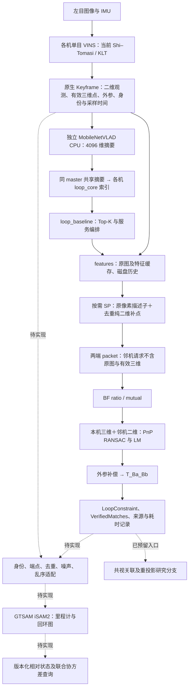

# loop→GTSAM 交接：当前平台、接口约定与验证执行计划

更新日期：2026-10-29。用户原定名 `loop->gtsam交接.md`；工作区所在 exFAT 文件系统不允许文件名含 `>`，故以 Unicode 箭头命名 `loop→gtsam交接.md`。

**交接结论：VIO→关键帧→全局检索→BF/PnP→机体相对位姿约束的链路已走通；GTSAM 当前只有协议和输入校验，没有 iSAM2 实现、消费节点或状态协方差查询实现。** 本文将已实现事实、下一阶段设计及验证计划分开记录，不将拟议接口当作已有功能。本次文档整理没有新执行完整回放或后端仿真。

## 1. 背景与本阶段目标

工程由单目 VIO、按关键帧触发的回环模块，以及未来每机独立维护的协同图组成。目标是每机依据自身获取的信息优化本机及所维护邻机状态，并最终用不确定性调节前端关键帧、检索与通信频率。这属于**去中心化估计**；当前没有跨机一致性优化或 ADMM，不应写成已实现分布式共识求解。

主线先建立可复现算法平台：可控输入、确定身份、明确坐标、可追溯约束、增量求解、版本化状态查询。并行研究 VIO 与 PnP 的信息耦合、噪声校准与协方差一致性。第一阶段可采用**显式记录来源和适用范围的近似噪声**运行工程原型，但不能将条件协方差宣称为真实可信的调度依据。

暂缓：LG 替换、SP 性能优化、跨机共视重投影因子、UWB、网络通信桥及反馈 VIO。不得把 S3E 原始右目加入线上单目算法；右目仅作为离线诊断来源。

## 2. 当前工作流程与责任边界



| 模块 | 当前作用 / 入口 | 状态 |
|---|---|---|
| VINS 导出 | `/agentX/vins/keyframes`、`/agentX/vins/states` | 已实现；三维点是该关键帧相机系的 VIO 条件估计 |
| features | `describe_keyframe`，发布 `/agentX/keyframes` | 默认按需 SP；保留 VIO 像素/ID/三维对应，追加点只有二维 |
| global_descriptor | `global_agent.launch`，`/rdswarm/summaries` | 独立 CPU，正式 VIO 关键帧触发；不是 VIO 状态向量 |
| loop_core | `query_candidates`、`get_local_features`、`fetch_peer_features`、`verify_loop` | 服务已实现；本身不自动编排 |
| loop_baseline | `loop_baseline.launch` | 自动 query→describe→等待缓存→fetch→BF/PnP→发布与存档 |
| 后端 | `BackendInterface`、`validateConstraint` | 仅接口与校验，不存在可运行优化节点 |
| 共视 | `CoVisibilityBundleSink` 等 | 仅入口，不构造机间地标/重投影约束 |

`/rdswarm/summaries` 是同 ROS master 的逻辑分发；不能据此宣称已实现真实跨机 WiFi/跨 master 通信。邻机服务响应不携带原图，但当前 `LocalFeaturePacket` 仍有通用结构占位，不是最终带宽最优编码。

普通帧超时 fallback 只在仍有初始化 VIO 状态和同采样时间图像、但长时间无正式关键帧时搜索；默认关闭。它只发布候选，不替代正式关键帧端点，不发布回环位姿。VIO 完全中断时也不能依靠该机制恢复状态。

## 3. 已完成验证与证据边界

| 实验 | 结果 | 能说明什么 |
|---|---|---|
| 40 秒 VIO 记录顺序离线检索 | 112 关键帧；318 帧对；95 几何通过；0 处理错误 | 真实关键帧的全链计算已运行 |
| 同 master ROS 集成 | 16 关键帧、16 摘要、8 次自动验证、至少 1 接受 | 节点间调用、历史回取及自动输出可用 |
| RAM 工作集=1、磁盘历史 | 历史取回成功；对端原图未传输 | 内存缓存淘汰不等于丢失历史 |
| fallback | 1 次推理、3 候选，未作为正式关键帧入索引 | 只搜索的边界有效 |
| pair-00152 原 PnP 与单双目 | 原解可复现；Carol 固定 11 点两来源平移向量差约 5.3 cm | 该帧数据解释/几何内部一致性证据 |

记录入口：`results/global_loop_recorded_40s/summary.json`、`logs/global_loop_services_final/summary.json`。95 对是几何验收帧对，不是独立正确回环数。VLAD 中位 8.43 ms，SP 推理＋增补中位 407.36 ms；40 秒输入离线墙钟约 79.29 秒，未证明实时吞吐。

S3E 文本参考追溯为 GNSS，存在质量和高度分段异常；0.919/2.491 m 只是未经认证参考的长度差。双目标定语义未核实，±0.1° 是敏感性扰动。**不能用这些数据认证后端精度或协方差一致性。** 详细证据见 [回环问题](回环问题.md)、[时间与参考审查](S3E_REFERENCE_TIME_AUDIT.md)、[双目审查](单双目结果相互验证对比.md)。

## 4. 后端必须保持的数据约定

### 4.1 身份、时间与坐标

- `FrameKey = (agent_id, session_id, frame_id)`；当前 frame_id 为原始图像采样纳秒。不要只以 agent_id 或时间戳当图节点键。
- VIO reset 新 epoch/session，不能静默连接重置前后轨迹。唯一 GTSAM Key 映射由后端维护，不应直接把 64 位纳秒塞入字符 Symbol 的索引部分并假定无截断/碰撞。
- `Keyframe.header.stamp` 是采样时间；到达时间、ROS 播放时间和求解时间分开记录。回环两端允许异时，不移到统一“当前帧”。
- `body_pose_vio` 是该设备局部 VIO 世界系中的 body 位姿；不同机局部世界系不能直接作位置差。`vio_frame_id` 必须连同 session 解释，不能只凭字符串 `world` 判定相同世界系。
- `body_T_camera` 把相机系坐标变换到 body。三维特征 `position_camera` 位于采样关键帧相机系，不能当世界点或绝对精确常量。
- `feature_id` 高位为 1 的追加二维点只有当前 FrameKey 内身份，没有跨帧地标轨迹。原 VIO ID 也需要 agent/session 范围。

### 4.2 位姿与因子方向

约定 `T_XY` 把 Y 系点映射到 X 系。PnP 用 a 相机三维点和 b 相机归一化二维点，K=I，得到 `T_Cb_Ca`；输出：

```text
Z_ab = T_Ba_Bb
     = T_Ba_Ca * inverse(T_Cb_Ca) * inverse(T_Bb_Cb)
```

未来全局图状态定义 `X_a = T_W_Ba`、`X_b = T_W_Bb`，则：

```text
预测相对位姿：X_a.between(X_b) = inverse(X_a) * X_b
对应因子：BetweenFactor<Pose3>(key_a, key_b, Z_ab, noise)
```

测量与因子端点必须同向。**逆变换时不能只把平移取负**；协方差也须按切空间约定通过 Jacobian/Adjoint 转换，不能原样复制。首个方向验收采用非零旋转和平移的合成例子。

### 4.3 现有消息到 C++ 协议的映射

| 现有接口 | 关键字段 / 行为 | 接入时缺口 |
|---|---|---|
| `Keyframe.msg` → `PoseInput` | key、stamp→capture_time_ns、vio_frame_id、body_pose_vio；initialized、capture_stamp_exact 作为适配器检查 | Keyframe 没有位姿协方差；PoseInput 不包含其有效性检查字段，适配器需保留诊断 |
| `LoopConstraint.msg` → `PoseConstraint` | observation_id、key_a/b、relative_pose→a_T_b、covariance、valid、source | C++ PoseConstraint 不携带 stamps、source_observation_ids、geometry_verified 等完整元数据；另存来源记录，不能转换时丢弃 |
| `VerifiedMatches.msg` | 两端 key/stamp、模型、ID、距离和 inlier、geometry_verified | 是关联/诊断，不是独立第二条位姿观测 |
| `VioState.msg` | pose、velocity、initialized，及 covariance_valid/source | 当前未知协方差不能用零阵；仅边缘协方差也不能得到增量噪声 |
| `QueryRelativeState.srv` | 两端 key；success/status/version/data_cutoff、pose、12×12 joint、6×6 relative | 尚无节点；C++ RelativeState 没有 data_cutoff，需实现时补适配或扩展 |

协方差按 row-major，切空间顺序 **`rx ry rz tx ty tz`**，旋转弧度、平移米。记录右/左扰动、表达坐标及与 GTSAM residual 的关系；不能仅交换数组顺序就宣称兼容。

## 5. 噪声、相关性与协方差查询

### 5.1 当前约束为何还不能直接进后端

`src/rdswarm_loop/config/loop.yaml` 默认 `covariance/use_nominal: false`，因此几何通过的 LoopConstraint 通常仍有 `covariance_valid=false`。`validateConstraint()` 会拒绝未知噪声；还要求身份不同、observation_id 非空、位姿有限、协方差来源非空、有限、对称正定。

已有显式名义配置可用于**工程近似试验**：`use_nominal=true`，当前配置 `rotation_std=0.03 rad`、`translation_std=0.10 m`，生成对角方差，标记 `configured_nominal_not_calibrated`。这些是已有配置值，不是推荐的已校准精度。不能给旧 JSON/二进制中的 invalid 协方差静默补单位阵，也不能将共享名义噪声包装成校准值。

建议默认严格模式拒绝未知噪声；另设明确启用、日志可辨别的实验模式，使用显式近似噪声并标明 covariance 仅对假定图模型有效。VIO 增量同样需要说明噪声来源，当前没有自动导出 VIO 增量噪声。

### 5.2 VIO 增量如何构造

同 agent、同 session 的相邻关键帧 i/j：

```text
Z_ij = inverse(T_V_Bi) * T_V_Bj
```

两端局部世界系必须一致。不能把每个 VIO 绝对位姿都当独立全局 prior，再重复加入相邻增量。首阶段建议松耦合 Pose3 图；IMU 因子、速度/偏置状态及滑窗先验转移另行设计。

设联合协方差为 `P = [[Pii,Pij],[Pji,Pjj]]`，增量函数 Jacobian 为 `[Ji,Jj]`，增量协方差含：

```text
Σ_delta = Ji Pii Jiᵀ + Ji Pij Jjᵀ + Jj Pji Jiᵀ + Jj Pjj Jjᵀ
```

不能只加 Pii/Pjj。即使得到了增量的边缘噪声，连续增量之间仍可能因共享 VIO 滑窗/观测而相关；独立 BetweenFactor 是需要标记和评估的近似。

### 5.3 PnP、共视与重复信息

PnP 三维点来自 VIO 条件估计；重新提 SP 描述子、换匹配器或只使用邻机二维，不会让它与 VIO 先验自动独立。图中若没有建模这种耦合，GTSAM 不会从 `source_observation_ids` 自动恢复相关性。该字段用于追溯/策略，不是自动去相关算法。

同一次匹配生成的 PnP 与未来重投影因子，应择一作为主观测，或明确联合建模。邻近回环、正反求解、消息转发不应作为无关新信息重复累积。鲁棒核可以限制异常因子的影响，不能消除相关性或证明噪声校准正确。

### 5.4 联合与相对状态查询

返回同一求解快照下 `[pose_a(6), pose_b(6)]` 的完整 12×12 joint covariance，包括交叉块。对 `f(Xa,Xb)=Xa.between(Xb)` 在相同切空间取 Jacobian J：

```text
Σ_relative = J * P_joint * Jᵀ
```

优先使用 GTSAM 的局部 Jacobian 并以数值差分核对，不能将两个 6×6 边缘阵直接相加。响应包括 snapshot_version、data_cutoff、成功/失败状态；断连、未优化、未知 key 或奇异图不返回伪有效零矩阵。`data_cutoff` 的定义应明确；建议定义为已提交输入流的处理水位，另记各因子来源时间，不能用墙钟假冒，也不能暗示水位前所有消息已到齐。

Gauge prior 决定条件协方差解释。不同 gauge/信息集的矩阵不能不加说明就比较“谁更可观”；状态协方差变小不等于真实误差变小。调度前需可信参考下的 Monte Carlo、NEES/覆盖率等一致性评估，并保留模型不匹配/相关观测的对照。

## 6. 接入 GTSAM 的实施顺序（待执行）

### A. 输入适配、图身份与来源

1. 实现 BackendInterface 与 ROS 适配节点，维护完整 FrameKey→GTSAM Key 双向表、session 边界及提交日志。
2. 订阅正式关键帧与 `/agentX/loop_constraints`。首轮只由一个 baseline worker 发起回环，后端仍需 observation_id 幂等去重和端点反向重复检查。
3. **补齐邻机端点状态来源。** 当前 peer packet 不带 body_pose_vio，不能只订阅本机关键帧＋本机 loop 就假定邻机轨迹已经存在。同 master 原型可显式导入两端 Keyframe 元数据/轨迹，真实去中心化版本需设计邻机状态与里程计摘要传输，并计入通信成本。
4. 回环早于端点到达时有界挂起，端点就绪后重放；超时/缺帧记录失败原因。不能给未知端点伪造零位姿或默默跳过。
5. 回环可能发布成功后、存档中途失败并重试；SQLite finished 去重不能替代后端 observation_id 幂等处理。同源反向约束与共享观测只去重/保留来源不等于统计去相关。

### B. 首轮松耦合 Pose3 图

1. 使用同 session VIO 相对增量、显式噪声模型、回环 BetweenFactor 和 iSAM2 更新；先不增加 IMU 或重投影因子。
2. 每机 VIO 的局部地图坐标不同。以一台为共同 gauge，另一台通过首个可信跨机变换初始化，不能将两条局部轨迹都当同一世界坐标插入。
3. 断连分量独立管理/暂缓联合查询；首个连边到来时处理分量对齐和初始化。若用临时各分量 prior，连接时须明确移除/替换，不能将任意局部坐标系用强 prior 永久锁死。
4. 首版固定合理 gauge，不将固定 gauge 造成的低协方差当作可观性提升。对 metric Pose3 图的 6 自由度 gauge 与后续保留重力约束的模型分别说明。
5. 重复回环、异常回环、退化几何保留拒绝或鲁棒处理日志；阈值和鲁棒核不是精度认证。输出轨迹、因子残差、增量提交版本及耗时。

### C. 状态和协方差服务

实现 `relativeState()` 与 `QueryRelativeState`：位姿和协方差来自同一快照；明确重线性化/提取 covariance 时机、并发、未连通及数值失败。先验证联合块与数值 Jacobian，再提供调度消费接口。

### D. 实验与研究分支

完成合成几何、统计仿真和真实回放三层验收后，再讨论前端调度。共视重投影、跨机摘要先验与长期边缘化分别提交设计，不在一次“接后端”改动中隐式叠加。

## 7. 预留代码与文档接口

| 入口 | 已存在内容 | 后续需要补齐 / 建议交付文档（尚未创建） |
|---|---|---|
| `src/rdswarm_backend/include/rdswarm_backend/backend_interface.hpp` | PoseInput、PoseConstraint、RelativeState、插入/更新/查询抽象类 | 实现类、生命周期和失败状态；`GTSAM_BACKEND_IMPLEMENTATION.md` |
| `src/rdswarm_backend/src/backend_contract.cpp` | 输入有效性/噪声检查 | ROS 元数据适配、去重、端点队列、session/gauge 管理 |
| `src/rdswarm_msgs/srv/QueryRelativeState.srv` | 位姿、联合/相对协方差、版本及 cutoff 协议 | 服务节点与快照定义；`GTSAM_COVARIANCE_VALIDATION.md` |
| `src/rdswarm_loop/include/rdswarm_loop/covisibility_interface.hpp` | CoVisibilityObservationSink、CoVisibilityBundle、CoVisibilityBundleSink | 地标身份、轨迹、像素噪声与数据所有权；`COVISIBILITY_FUSION_DESIGN.md` |
| `baseline/constraints/*.provenance.json` | 来源、两端 key/stamp、VIO 条件三维标签 | landmark_tracks/joint_covariance/calibration_fingerprint 当前均不可用，后续补 schema 与版本 |
| `LoopConstraint.source_observation_ids` | 来源观测标识 | 关联图/重复信息策略，不代表已有交叉协方差 |
| 本文第 8 节 | 可运行流程、待开发仿真矩阵 | 合成生成器、后端回放器、统一指标；`GTSAM_SIMULATION_REPORT.md` |

共视入口保存 local/remote packet 和匹配，当前未实现调用该 sink 的融合消费者。三维点/深度方差未知时保持无效，高位二维 ID 不得直接升级为全局地标。

后续报告至少包含：代码版本与 dirty diff、配置、模型/标定 hash、session、随机种子、输入顺序与到达时间、因子来源/噪声模型、gauge、图快照、失败原因和复现命令。

## 8. 仿真与回放执行方案

### 8.1 当前可直接运行：前端及回环复现

以下为 Bash，每个终端设置同一工作区。zsh 使用对应 `setup.zsh`，不要在 zsh 中 source Bash 设置。

```bash
cd "/media/walker/My PSSD/tmp/论文/RDSwarm"
source /opt/ros/noetic/setup.bash
source devel_cpu/setup.bash
ctest --test-dir build_cpu --output-on-failure
/usr/bin/python3 tests/global_descriptor_test.py
```

当前构建依赖本机 GTSAM；CMake 请求 4.2，README 记录本机头文件 4.3a1。实现时记录实际库/头文件版本并锁定兼容配置，不能仅依据 CMake 版本下限。

离线记录关键帧检索，无需 ROS master；输出使用尚不存在的新目录：

```bash
/usr/bin/python3 scripts/evaluate_global_loop.py \
  --keyframes results/s3e_loop_validation/keyframes.bag \
  --output results/loop_handoff_20261029_offline --top-k 3 --max-points 400
```

仅在需要重新执行 ROS 集成测试时运行，选择空闲端口与新日志目录：

```bash
/usr/bin/python3 tests/global_loop_services_test.py \
  --output logs/loop_handoff_20261029_services --port 11630
```

`evaluate_global_loop.py` 输出逐对 JSON、packet 和统计，**不是已有的 GTSAM 输入回放器**；加载后端必须实现消息转换/适配，不能把 JSON 当成 LoopConstraint 二进制。

### 8.2 当前可直接运行：ROS 自动回环链路

完整分终端说明见 [GLOBAL_LOOP_BASELINE.md](GLOBAL_LOOP_BASELINE.md)。以下固定一份新目录，各终端使用相同路径。依次启动：

1. `roscore`；另一个终端 `rosparam set /use_sim_time true`，在其他节点启动前设置。
2. 两机 feature 节点、loop core 和 global 节点；**每行分别常驻一个已 source 的终端，不要在同一终端串行粘贴**。

```bash
roslaunch rdswarm_bringup describe_agent.launch agent_id:=0 cache_directory:="$PWD/results/loop_handoff_20261029/agent0/features" memory_keyframes:=8
roslaunch rdswarm_bringup describe_agent.launch agent_id:=1 cache_directory:="$PWD/results/loop_handoff_20261029/agent1/features" memory_keyframes:=8
roslaunch rdswarm_bringup loop_agent.launch agent_id:=0 summaries_topic:=/rdswarm/summaries cache_directory:="$PWD/results/loop_handoff_20261029/agent0/loop" memory_keyframes:=8 remote_cache_limit:=8
roslaunch rdswarm_bringup loop_agent.launch agent_id:=1 summaries_topic:=/rdswarm/summaries cache_directory:="$PWD/results/loop_handoff_20261029/agent1/loop" memory_keyframes:=8 remote_cache_limit:=8
roslaunch rdswarm_bringup global_agent.launch agent_id:=0 cache_directory:="$PWD/results/loop_handoff_20261029/agent0/global"
roslaunch rdswarm_bringup global_agent.launch agent_id:=1 cache_directory:="$PWD/results/loop_handoff_20261029/agent1/global"
```

3. 仅运行一个自动 worker：

```bash
roslaunch rdswarm_bringup loop_baseline.launch agent_id:=0 \
  output_directory:="$PWD/results/loop_handoff_20261029/agent0/baseline" top_k:=3
```

4. 另开终端记录端点与约束，再启动播放。目录在节点初始化后已建立：

```bash
rosbag record -O "$PWD/results/loop_handoff_20261029/handoff_inputs.bag" \
  /agent0/vins/keyframes /agent1/vins/keyframes \
  /agent0/loop_constraints /agent0/verified_matches
```

```bash
rosbag play --clock --pause -r 0.5 results/s3e_loop_validation/keyframes.bag
```

按空格后播放。结束后让 worker 排空再停止记录和节点；未处理队列不能算作算法拒绝。service call 当前没有可靠执行超时，须从日志检查停滞。bag 记录发布事件，来源旁文件、配置、模型 hash 需一起存档。

以上沿用默认无效协方差，只验证消息链路。未来工程名义噪声实验须在启动/发布约束之前明确设置 agent0 loop core 参数，例如：

```bash
rosparam set /agent0/loop_core/covariance/use_nominal true
rosparam set /agent0/loop_core/covariance/rotation_std 0.03
rosparam set /agent0/loop_core/covariance/translation_std 0.10
```

这些值仅演示现有配置接口，实验记录必须标为未校准。不能给已发布/保存的约束追补噪声，不能替代 VIO 里程计噪声设计。默认严格后端应拒绝 invalid 约束。

若改为传感器→VIO 全流程，按 [S3E_DUAL_VINS.md](S3E_DUAL_VINS.md) 启动两路 VIO，使用 `cache_keyframes:=false` 关闭旧 loop_inputs 缓存，指定新 session/output_path；替换第 4 步为**一个播放器同时回放** Alpha/Carol 单目 bag。不要同时播放 keyframes.bag，也不要用两个独立播放器发布 `/clock`。旧 40 秒关键帧对应的实验配置不保证与当前默认 YAML 相同，应保存实际配置，不能要求重跑 VIO 逐帧复现旧帧数。

### 8.3 待开发：GTSAM 合成与统计仿真

**当前没有以下生成器/后端启动命令；本表是下一阶段开发及验收要求。** 不应把真实数据回放或一次 CTest 当成已完成这些仿真。

| 用例 | 输入与干预 | 验收内容 |
|---|---|---|
| 无噪声双机 | 独立局部坐标、非零旋转/平移、异时回环、已知 metric GT | 固定 gauge 后恢复真值；BetweenFactor 方向与外参补偿正确 |
| 里程计独立高斯噪声 | 已知模型、仅 VIO 增量 | 残差与真值误差统计符合设定；不用拟合残差替代真值 |
| VIO＋回环 | 同轨迹、相同种子、已知噪声回环 | 与 VIO-only 对照；误差/协方差及代价变化可解释 |
| 相关观测 | 显式模拟共享误差，对比正确联合模型与独立因子近似 | 检查过度自信；不能只看 covariance 变小 |
| 异步乱序 | 延迟/重复/反向重复、先回环后关键帧、缺帧 | 有界挂起、幂等提交、明确失败；不伪造状态 |
| session/reset | agent 重启与旧消息迟到 | 不跨 session 错连；Key 映射无冲突 |
| 图断连与首次连接 | 两个局部分量后出现跨机边 | 不锁死任意局部原点；断连查询失败语义明确 |
| 异常回环 | 错误 Z、退化点集、强相关邻近回环 | 拒绝/鲁棒机制可审查；不宣称保证过滤所有错误 |
| covariance | 已知联合分布、可复现独立采样 | joint 顺序、交叉块及相对 Jacobian；覆盖率/NEES |
| 长时压力 | 原速/加速输入、索引增长与有界缓存 | 排队、丢弃、耗时、RAM/磁盘与恢复是否重加因子 |

合成噪声 Monte Carlo 固定 seed 清单，分开调参和验收随机样本；NEES 自由度/置信区间、gauge、有效样本数与重线性化设置在报告明确。不存在通用的“协方差越小越好”通过标准。

### 8.4 真实回放后端的验收边界

实现后在同一记录上比较 VIO-only 与 VIO＋loop；先验、噪声、到达顺序、鲁棒设置与重复因子策略可审查。记录接收/挂起/拒绝/提交数量、连通分量、位姿/旋转残差、优化耗时、队列、水位和 covariance 查询失败。

S3E 当前只能验收接口、执行稳定性和内部一致性。真实定位精度、NEES/置信覆盖、尺度误差及调度收益，应使用可信独立真值或经确认的参考；仿真通过也不能替代真实回环精度验证。

## 9. 下一阶段完成标准

1. 后端实现与 ROS 节点可运行，关键帧和回环端点完整；未知噪声/未知 key/断连有明确行为。
2. 合成无噪声及方向/乱序/重复/session 测试通过，图连接与初始化可复现。
3. 同一快照可查询相对位姿、完整联合协方差及传播后的相对协方差；数值验证通过。
4. 名义模型与校准模型可辨别；未处理的 VIO-PnP 耦合被记录，不掩盖为“已由 GTSAM 解决”。
5. 回放结果、耗时/缓存/因子计数归档，未完成精度认证时不宣称调度已获得可信系统不确定性。

## 10. 相关文档

- [回环问题：S3E 与研究问题](回环问题.md)
- [观测耦合](观测耦合.md)、[研究路线 HTML](研究路线.html)
- [当前接口](INTERFACES.md)、[全局回环运行入口](GLOBAL_LOOP_BASELINE.md)
- [S3E 双路 VIO 与时钟](S3E_DUAL_VINS.md)、[数据转换](S3E_CONVERSION.md)
- [源时间与参考来源](S3E_REFERENCE_TIME_AUDIT.md)、[双目离线对照](单双目结果相互验证对比.md)
